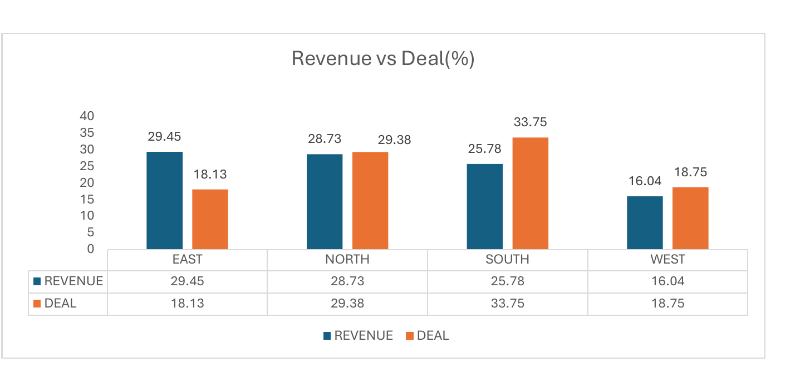
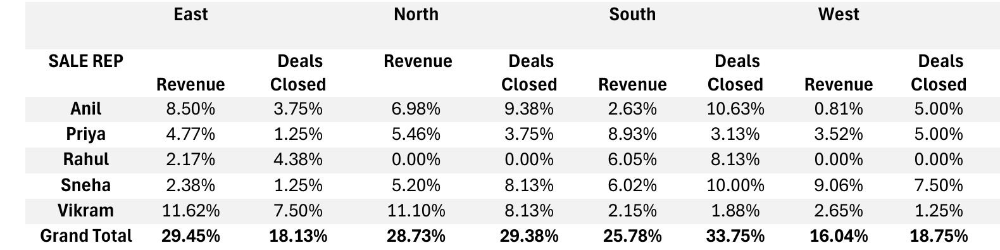
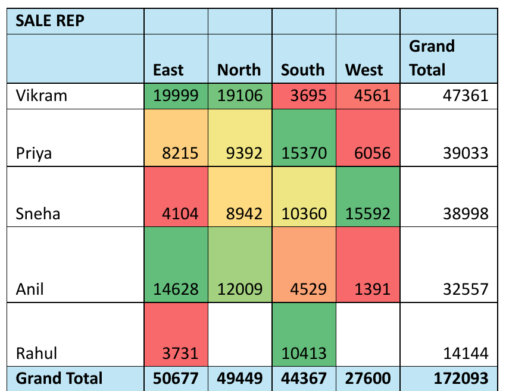
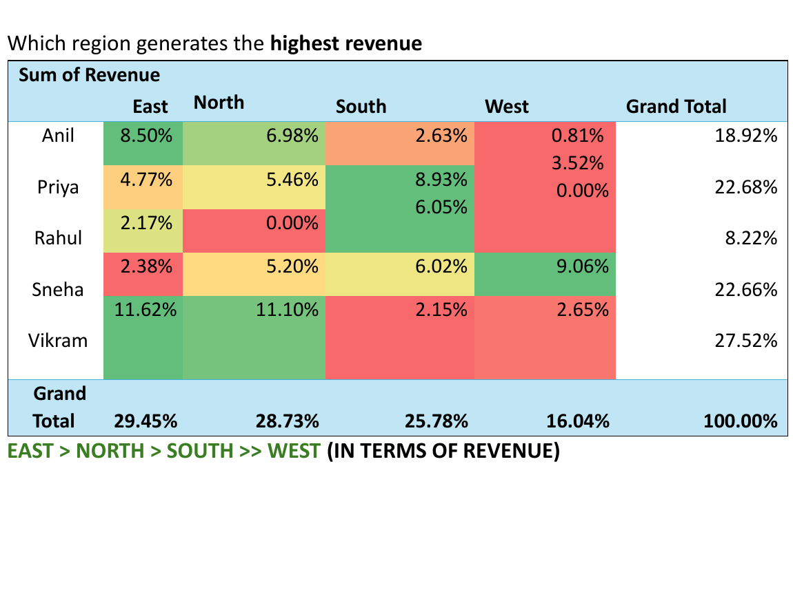
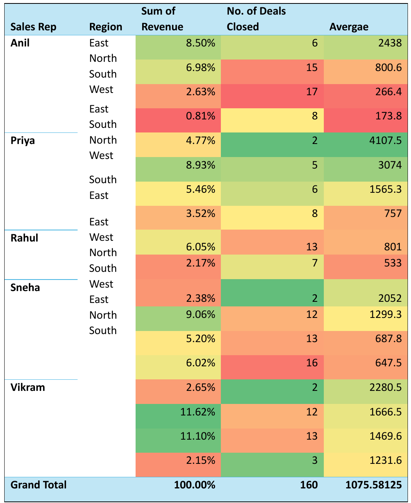
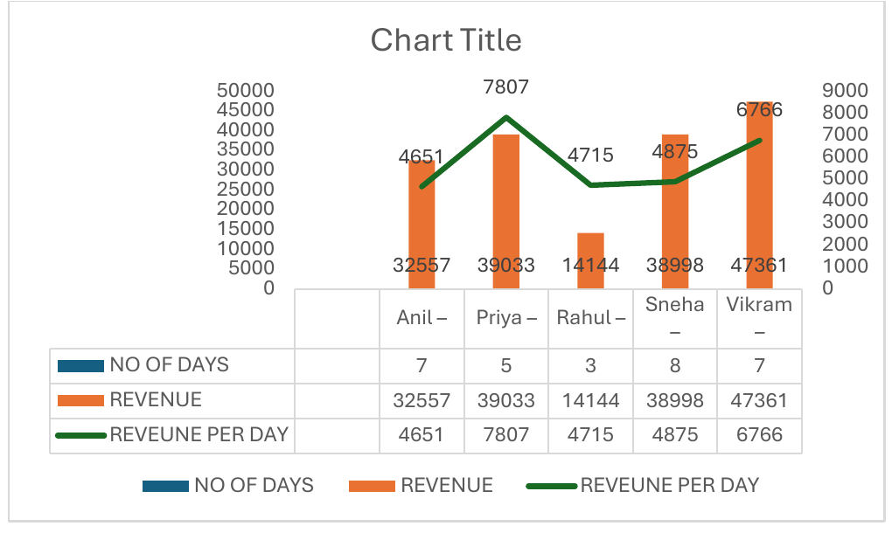
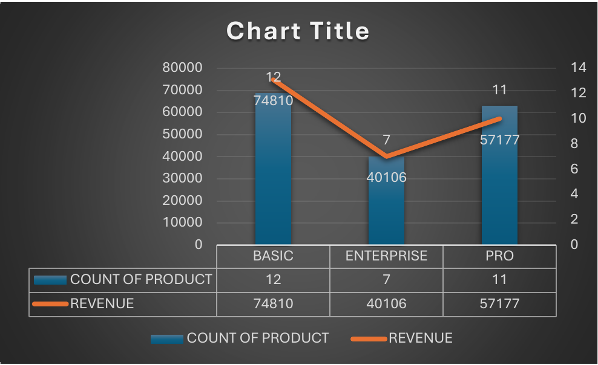
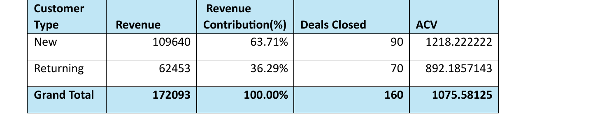

# Sales Performance & Revenue Optimization

An Excel-based sales analysis project by **Vinayak Khandelwal**, comparing revenue, deal volume and revenue per deal across regions, sales representatives, product tiers and customer types.

The project combines a PivotTable-driven dashboard with a written audit to identify where sales volume translates into revenue and where pricing, upselling or territory coverage deserve a closer look.

## Project at a glance

| Metric | Value |
| --- | ---: |
| Period covered by the source records | 1-30 January 2025 |
| Source records | 30 |
| Deals closed | 160 |
| Total revenue | ₹172,093 |
| Average revenue per deal | ₹1,075.58 |
| Sales representatives | 5 |
| Regions | 4 |
| Product tiers | 3 |

Each source row contains an aggregate `Deals Closed` value. The 30 records represent **160 deals**, not 30 individual transactions.

## Business questions

- Which regions generate the most revenue, and how does that compare with their share of deals?
- Which representatives lead on revenue, volume and average revenue per deal?
- How do Basic, Pro and Enterprise contribute to revenue?
- How do new and returning customers differ in revenue and deal value?
- Which segments should be investigated for upselling, coaching or wider sales coverage?

## Repository files

- **[Excel workbook](<Excel cleaned data new  (version 2).xlsx>)**: source data, calculations, PivotTables, charts and dashboard slicers.
- **[`images/`](images/)**: charts and tables cropped from the audit report, used in this README.
- **[Sales audit report](<SALE REP REVIEW 2.pdf>)**: written analysis, representative profiles and proposed business actions.

This repository contains an Excel workbook and a PDF report. No Python scripts, SQL queries or Power BI file are included.

## Tools and techniques

- Microsoft Excel
- PivotTables and PivotCharts
- Slicers for Sales Rep, Region, Customer Type, Product and Day
- `SUMIF`, `SUMIFS` and `GETPIVOTDATA`
- Revenue-share, deal-share and average-revenue-per-deal comparisons
- Written business analysis and representative-level SWOT analysis

## Workbook guide

| Worksheet | Purpose |
| --- | --- |
| `Excel cleaned data` | Source records and supporting representative-level calculations |
| `PIVOT TABLE` | Summary PivotTables for regional and representative comparisons |
| `Pivot_table ` | Detailed breakdowns, KPI calculations and supporting charts |
| `Dashboard` | Dashboard view with charts, KPI cells and slicers |

The second detailed pivot worksheet is named `Pivot_table `, including a trailing space.

### Source data fields

| Field | Description |
| --- | --- |
| `Date` | Date attached to the sales record |
| `Day` | Day number used for filtering |
| `Sales Rep` | Anil, Priya, Rahul, Sneha or Vikram |
| `Region` | East, North, South or West |
| `Deals Closed` | Number of deals represented by the row |
| `Revenue` | Revenue associated with the row |
| `Customer Type` | New or Returning |
| `Product` | Basic, Pro or Enterprise |

## Charts and tables from the audit report

The images below are cropped directly from the project's own report (`SALE REP REVIEW 2.pdf`). They are not redrawn, so their original labels (including the default "Chart Title") are unchanged. The notes under each image explain how to read it and where it differs from the recalculated workbook totals.

### Revenue vs deal share by region

<p align="center">
  
</p>

- **East leads revenue** (29.45%) while closing only 18.13% of deals.
- **South leads deal volume** (33.75% of deals) but contributes 25.78% of revenue.
- **West has the lowest revenue share** (16.04%).

<p align="center">
  
</p>

### Revenue by representative and region

<p align="center">
  
  
</p>

- **Vikram** has the most revenue (₹47,361), driven by East and North.
- **Priya** is strongest in South; **Sneha** in West; **Anil** in East and North.
- **Rahul** has the lowest revenue (₹14,144) and no revenue in North or West.

### Revenue per deal by representative and region

<p align="center">
  
</p>

The report labels the last column "Average" (misspelt in the original) and the metric as ACV. Both mean revenue divided by deals closed. In the original image, the Region labels are not vertically aligned with their rows, so read the values against this table, recalculated from the workbook:

| Representative | Region | Revenue share | Deals closed | Revenue per deal |
| --- | --- | ---: | ---: | ---: |
| Anil | East | 8.50% | 6 | 2,438.0 |
| Anil | North | 6.98% | 15 | 800.6 |
| Anil | South | 2.63% | 17 | 266.4 |
| Anil | West | 0.81% | 8 | 173.9 |
| Priya | East | 4.77% | 2 | 4,107.5 |
| Priya | North | 5.46% | 6 | 1,565.3 |
| Priya | South | 8.93% | 5 | 3,074.0 |
| Priya | West | 3.52% | 8 | 757.0 |
| Rahul | East | 2.17% | 7 | 533.0 |
| Rahul | South | 6.05% | 13 | 801.0 |
| Sneha | East | 2.38% | 2 | 2,052.0 |
| Sneha | North | 5.20% | 13 | 687.8 |
| Sneha | South | 6.02% | 16 | 647.5 |
| Sneha | West | 9.06% | 12 | 1,299.3 |
| Vikram | East | 11.62% | 12 | 1,666.6 |
| Vikram | North | 11.10% | 13 | 1,469.7 |
| Vikram | South | 2.15% | 3 | 1,231.7 |
| Vikram | West | 2.65% | 2 | 2,280.5 |

Some of these figures rest on very few deals (for example Priya in East and Sneha in East, 2 each), so treat revenue per deal at that level with caution.

### Sales consistency by representative

<p align="center">
  
</p>

Revenue per day is revenue divided by "No of days", which is the number of source records for each representative (Anil 7, Priya 5, Rahul 3, Sneha 8, Vikram 7). It is not a deal count. The report reads this as Priya having the highest sales velocity (7,807 per day) and Vikram second (6,766).

### Product mix

<p align="center">
  
</p>

| Product | Records (chart "Count of Product") | Deals closed | Revenue |
| --- | ---: | ---: | ---: |
| Basic | 12 | 54 | ₹74,810 |
| Enterprise | 7 | 43 | ₹40,106 |
| Pro | 11 | 63 | ₹57,177 |

The chart's "Count of Product" counts source records, not deals closed. Pro revenue is **23.57% below Basic** using the recalculated totals (the report rounds this to 24%). The report describes Pro and Basic as having similar volume; by deal count, Pro closed 63 deals against Basic's 54.

### Customer type

<p align="center">
  
</p>

- New customers: ₹109,640 (63.71%) across 90 deals, ₹1,218 per deal.
- Returning customers: ₹62,453 (36.29%) across 70 deals, ₹892 per deal.
- Returning revenue per deal is **26.76% below** new customers (the report rounds this to 26.7%).

## KPI definitions

```text
Total revenue = SUM(Revenue)
Total deals = SUM(Deals Closed)
Average revenue per deal = Total revenue / Total deals
Revenue share = Segment revenue / Total revenue
Deal share = Segment deals / Total deals
Returning-customer gap = (New average - Returning average) / New average
Pro vs. Basic revenue gap = (Basic revenue - Pro revenue) / Basic revenue
```

The report uses the label **ACV** for average revenue per deal. Here, that metric means `Revenue / Deals Closed`; the dataset does not establish annual contract value.

## How to explore the project

1. Download the workbook and PDF using the links above, or choose **Code > Download ZIP** on GitHub and extract the files.
2. Open the `.xlsx` file in Microsoft Excel desktop to work with the native PivotTables, charts and slicers.
3. Start on `Dashboard`, then use the available slicers to explore segments. Clear the filters before comparing results with the full-dataset figures in this README.
4. Open `PIVOT TABLE` and `Pivot_table ` to inspect the supporting breakdowns.
5. Check the underlying records on `Excel cleaned data`, then read the PDF for the written interpretation and proposed actions.

### Working with new data

Work on a copy of the workbook. Update the source records, check each PivotTable's data-source range and use **Data > Refresh All**. The workbook includes fixed KPI references, including a hard-coded overall average, so updating the source data alone is not enough to guarantee that every dashboard number updates. Recheck totals and filter behavior after making changes.

## Scope and interpretation

- The dataset's original source and whether it is synthetic are not documented in the repository. Treat this as a portfolio analysis, not a verified company performance disclosure.
- Revenue is presented in INR, following the accompanying report.
- Product record counts are not deal counts. The PDF's product table counts 12 Basic, 11 Pro and 7 Enterprise records; the corresponding deal totals are 54, 63 and 43.
- Some narrative rankings and figures in the PDF differ from its tables. The summary above uses recalculated workbook source totals rather than copying those passages.
- Discounting, pricing discipline, sales-cycle length and the reasons for representative performance are hypotheses to investigate. They cannot be confirmed from these fields alone.
- The proposed actions are recommendations, not measured improvements in revenue or retention.

## Author

**Vinayak Khandelwal**  
[GitHub](https://github.com/CODEVK31)
